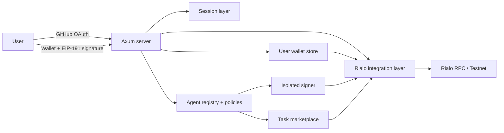

# Rialo AgentPay

**Programmable payments and a funded task marketplace for autonomous agents on Rialo.**

Rialo AgentPay gives software a wallet, an owner-defined spending policy, and an on-chain settlement path. Users can sign in with GitHub or an EVM wallet, fund a Rialo wallet, post paid tasks, and review work before releasing funds. Owners can register autonomous agents with independent wallets, scoped policies, and credential-authenticated payment APIs.

[](https://www.rust-lang.org/)
[](https://github.com/tokio-rs/axum)
[](https://rialo.io/)
[](https://www.postgresql.org/)
[](frontend/src/)

**Preview:** https://rialo-agentpay-preview.pages.dev/  
**Production:** https://rialo-agentpay.blitz.cloud/

> Testnet software. Use test funds only. Wallet sign-in proves account ownership; it does not import a private key into AgentPay.

---

## Contents

- [Why AgentPay](#why-agentpay)
- [What is included](#what-is-included)
- [Authentication](#authentication)
- [Architecture](#architecture)
- [Quick start](#quick-start)
- [Configuration](#configuration)
- [API overview](#api-overview)
- [Security model](#security-model)
- [Testing](#testing)
- [Deployment](#deployment)
- [Limitations](#limitations)
- [Documentation](#documentation)

---

## Why AgentPay

AI agents can already browse, negotiate, call APIs, and buy compute. The missing layer is settlement: a wallet the agent can use, rules the owner can enforce, and an auditable record of what happened.

AgentPay separates those concerns:

- **Identity** — a user account, or an agent with its own wallet.
- **Authority** — an explicit policy that decides whether a payment may happen.
- **Settlement** — a signed Rialo transaction, with a typed result or a typed error.
- **Evidence** — intent records, receipts, reconciliation, and owner-scoped activity.

There is no scheduler, no webhook, and no autonomous payment path. Every payment is an explicit authenticated request.

## What is included

| Capability | Details |
|---|---|
| **User wallets** | One persistent Rialo wallet per account; keys stay server-side and outside the web root. |
| **Dual sign-in** | GitHub OAuth **or** EVM wallet sign-in using `personal_sign`. |
| **Wallet support** | MetaMask, OKX Wallet, and Rabby via injected EIP-1193 providers. |
| **Agent registry** | Draft → active ⇄ paused → disabled lifecycle with independent agent wallets. |
| **Payment policies** | Per-transaction and daily limits, recipient/action allow-lists, deny-by-default rules. |
| **Direct payments** | Faucet funding and Rialo transfers with explicit balance status and typed errors. |
| **Agent payments** | Owner-session and `X-Agent-Credential` lanes share one gate chain and intent ledger. |
| **Task marketplace** | Create, claim, submit, review, reject, and pay tasks with reserved payouts. |
| **Receipts** | Deterministic, owner-scoped payment receipts and public proof surfaces. |
| **Reconciliation** | Unknown outcomes are held safely and resolved through typed terminals. |
| **Storage** | Filesystem by default; PostgreSQL supported for multi-instance deployments. |
| **Frontend** | Static HTML/CSS/JS served directly by Axum — no frontend build step. |

## Authentication

AgentPay supports two independent authentication methods. They appear as two separate cards in the frontend.

### GitHub OAuth

1. The user selects **GitHub**.
2. AgentPay redirects to GitHub with a CSRF `state` value.
3. GitHub returns to `/auth/github/callback`.
4. The server verifies `state`, exchanges the code, and creates an opaque session cookie.

### EVM wallet

1. The user selects **Wallet**, then chooses MetaMask, OKX Wallet, or Rabby.
2. The wallet requests account access.
3. The server issues a short-lived, single-use nonce and an exact login message.
4. The wallet signs the message with `personal_sign` (EIP-191).
5. The server recovers the signing address, verifies it against the nonce and address, consumes the nonce, and creates a session.

**What wallet sign-in does — and does not do**

- It proves control of an EVM address without exposing a private key or seed phrase.
- It creates a wallet-scoped AgentPay account; it does **not** automatically link to an existing GitHub account or import that account's data.
- Payment signing remains server-side through AgentPay's Rialo wallet layer. Wallet sign-in is authentication, not transaction signing.
- A production deployment must never introduce a user-controlled transaction-signing path solely for login.

## Architecture



Key boundaries:

- **One Rialo integration layer** owns the RPC endpoint and chain operations.
- **User and agent custody are separate.** Agent funded keys live in the isolated signer; AgentPay metadata mirrors only public addresses.
- **Policy enforcement is a pure check boundary** with a fixed gate order and deny-by-default semantics.
- **One intent ledger** covers both payment lanes; idempotency keys are globally exclusive.
- **Fail closed.** RPC, filesystem, or signer failures produce typed errors — never fabricated balances or success.

## Quick start

### Requirements

- Rust toolchain with Cargo (the crate uses edition 2024).
- A Rialo CLI installation (resolved from `RIALO_CLI_PATH`, then `PATH`, then the installed release path).
- A GitHub OAuth app for GitHub sign-in.
- Optional: PostgreSQL 16+ for `AGENTPAY_STORAGE_MODE=postgres`.

### Build and run

```bash
git clone https://github.com/Mahmoud514/rialo-agentpay.git
cd rialo-agentpay

cp .env.example .env
# edit .env with your OAuth app and Rialo RPC settings

cargo build --features server --bin server
./target/debug/server
```

Open <http://127.0.0.1:8080>.

The default bind address is `127.0.0.1:8080`; override it with `SERVER_ADDR`.

### GitHub OAuth app

Create an OAuth app with this callback URL:

```text
http://127.0.0.1:8080/auth/github/callback
```

Set `GITHUB_CLIENT_ID`, `GITHUB_CLIENT_SECRET`, and `GITHUB_REDIRECT_URI` in `.env`. The redirect URI must match exactly.

### Wallet sign-in

Wallet sign-in requires no OAuth app. Install MetaMask, OKX Wallet, or Rabby in the browser, open the app, choose **Wallet**, and sign the login message. The wallet menu reports whether each provider is detected.

> The preview deployment may show a wallet-provider warning for the `pages.dev` domain. Use a dedicated custom domain for a production wallet experience.

## Configuration

Copy `.env.example` to `.env`; it is loaded once at startup.

| Variable | Purpose | Required | Notes |
|---|---|---|---|
| `GITHUB_CLIENT_ID` | GitHub OAuth client id | GitHub login | Public identifier |
| `GITHUB_CLIENT_SECRET` | GitHub OAuth client secret | GitHub login | Secret — never commit |
| `GITHUB_REDIRECT_URI` | OAuth callback URL | GitHub login | Must match the OAuth app |
| `GITHUB_PREVIEW_REDIRECT_URI` | Preview-only callback URL | Optional | Isolated preview lane |
| `RIALO_RPC_URL` | Rialo RPC endpoint | Recommended | Defaults to localnet RPC |
| `RIALO_CLI_PATH` | Rialo CLI path | Optional | Falls back to `PATH` |
| `SERVER_ADDR` | HTTP bind address | Optional | Default `127.0.0.1:8080` |
| `AGENTPAY_COOKIE_SECURE` | Add `Secure` to session cookies | Production | Enable with TLS |
| `AGENTPAY_STORAGE_MODE` | `fs` or `postgres` | Optional | Default `fs` |
| `DATABASE_URL` | PostgreSQL connection string | PostgreSQL mode | Secret — never commit |
| `AGENTPAY_PG_LIVE` | Enable live PostgreSQL tests | Testing | Set to `1` |
| `DEV_LOGIN_USER_ID` | Local development login | Development | Loopback only; never production |
| `AGENTPAY_ISOLATED_SIGNER_LANE` | Enable isolated signer lane | Optional | Loopback-only signer |
| `AGENTPAY_ISOLATED_SIGNER_URL` | Isolated signer endpoint | With signer lane | Loopback only |
| `AGENTPAY_PROGRAM_ID` | Deployed Venus program id | Optional | Program integration |
| `AGENTPAY_PROGRAM_DIR` | Program artifact directory | Optional | Program integration |
| `AGENTPAY_PROGRAM_TEST_MAX_RLO` | Program payment cap | Optional | Unset/`0` = disabled |
| `AGENTPAY_LATCH_LANE` | Enable Latch transport lane | Optional | Opt-in |
| `AGENTPAY_LATCH_PROXY_URL` | Latch shim URL | With Latch lane | Loopback only |
| `AGENTPAY_LATCH_ID` | Public Latch correlation id | With Latch lane | Never a credential |

Never commit `.env`, wallet files, database URLs, OAuth secrets, or private keys.

## API overview

All API errors use a stable envelope:

```json
{
  "success": false,
  "error": {
    "code": "TYPED_CODE",
    "message": "Human-readable explanation"
  }
}
```

### Authentication

| Route | Method | Auth | Purpose |
|---|---|---|---|
| `/auth/github` | `GET` | — | Start GitHub OAuth |
| `/auth/github/callback` | `GET` | — | GitHub OAuth callback |
| `/auth/github/preview` | `GET` | — | Isolated preview OAuth lane |
| `/auth/github/preview/callback` | `GET` | — | Preview OAuth callback |
| `/auth/wallet/nonce` | `POST` | — | Issue a single-use wallet login nonce |
| `/auth/wallet/verify` | `POST` | — | Verify EIP-191 signature and create a session |
| `/auth/logout` | `POST` | Session | Clear session and cookie |

### User and marketplace

| Route | Method | Auth | Purpose |
|---|---|---|---|
| `/api/me` | `GET` | Session | Current user, wallet, balance status |
| `/api/faucet` | `POST` | Session | Testnet faucet |
| `/api/payment` | `POST` | Session | Direct Rialo transfer |
| `/api/tasks` | `GET` / `POST` | Session | List or create tasks |
| `/api/tasks/open` | `GET` | — | Public open-task listing |
| `/api/tasks/{id}/claim` | `POST` | Session | Claim a task |
| `/api/tasks/{id}/submit` | `POST` | Session | Submit work |
| `/api/tasks/{id}/review` | `POST` | Session | Review and settle or reject |

### Agents and policies

| Route | Method | Auth | Purpose |
|---|---|---|---|
| `/api/agents` | `GET` / `POST` | Session | List or create agents |
| `/api/agents/{id}/status` | `PATCH` | Session | Lifecycle transition |
| `/api/agents/{id}/policy` | `GET` / `PATCH` | Session | Read or replace payment policy |
| `/api/agents/{id}/payments` | `POST` | Session | Owner-initiated agent payment |
| `/api/agents/triggers/payments` | `POST` | `X-Agent-Credential` | Credential-authenticated agent payment |
| `/api/agents/{id}/payments/reconcile` | `POST` | Session | Reconcile an unknown outcome |
| `/api/agents/{id}/activity` | `GET` | Session | Owner-scoped activity |
| `/api/agents/{id}/stats` | `GET` | Session | Agent statistics |

The full route surface, including receipts, credentials, delegation, proof endpoints, and task reconciliation, is documented in the source module docs and `MARKETPLACE.md`.

### Health and public verification

| Route | Method | Auth | Purpose |
|---|---|---|---|
| `/api/health` | `GET` | — | AgentPay + Rialo RPC health |
| `/api/public/verify` | `GET` | — | Sessionless transaction verification |
| `/api/public/agents/{id}/proofs` | `GET` | — | Public payment proofs |

## Security model

- **No keys in the browser or frontend.** AgentPay never asks for a seed phrase or private key. Wallet login signs a human-readable message only.
- **Session cookies are opaque UUIDs.** Use TLS and `AGENTPAY_COOKIE_SECURE=1` in production.
- **Server-side wallet custody.** User and agent Rialo keys are stored outside the web root with restrictive permissions; agent funded keys can live in a separate isolated signer.
- **Deny by default.** Missing limits, empty allow-lists, unknown policies, and ambiguous ownership all deny.
- **Idempotency and reconciliation.** Replaying a payment key returns the stored verdict; unknown settlement outcomes are held, never auto-retried or refunded.
- **Fail closed.** Chain, storage, and signer failures return typed errors instead of synthetic balances or success.
- **No autonomous spending.** Agent payments require an explicit authenticated request and an applicable policy.

If you discover a security issue, do not open a public proof-of-concept. Contact the maintainers privately with reproduction steps and the affected deployment.

## Testing

```bash
# Build the server
cargo build --features server --bin server

# Server unit and integration tests
cargo +nightly test --features server --bin server --locked

# Optional: isolated signer tests
cargo build --release --locked --manifest-path tools/agentpay-signer/Cargo.toml
```

Filesystem-mode tests need no database. PostgreSQL suites require `AGENTPAY_PG_LIVE=1`, `AGENTPAY_STORAGE_MODE=postgres`, and a reachable database.

CI workflows live in `.github/workflows/`:

- `ci-tests.yml` — server and PostgreSQL test suites
- `docker-build.yml` — container build
- `security-audit.yml` — dependency and security checks

## Deployment

The frontend is static and can be served by Axum or by a separate static host. The backend requires a stateful process for wallet storage and the Rialo CLI/signer boundary; it is not a fit for a stateless edge-only runtime without an external store.

For the current preview, the frontend is deployed separately and proxies API/auth traffic to the Blitz backend. See `DEPLOYMENT.md` for environment, reverse-proxy, TLS, backup, and operational guidance.

Deployment checklist:

- [ ] Set a production `GITHUB_REDIRECT_URI` and matching OAuth app callback.
- [ ] Set `RIALO_RPC_URL` to the intended Rialo network.
- [ ] Enable TLS and `AGENTPAY_COOKIE_SECURE=1`.
- [ ] Configure durable storage and backups for wallet and agent metadata.
- [ ] Keep the isolated signer on loopback if enabled.
- [ ] Verify `/api/health` and a read-only wallet page after deployment.

## Limitations

- **Testnet only.** Do not use mainnet funds.
- **Wallet accounts are separate from GitHub accounts.** A wallet-scoped login does not inherit an existing GitHub account's agents, tasks, or wallet.
- **Wallet sign-in is authentication only.** It does not authorize AgentPay to move funds from the connected EVM wallet.
- **Agent payments are API-only.** There is no scheduler, webhook, or autonomous execution loop.
- **Program-mediated payments are kill-switched** until an operator sets `AGENTPAY_PROGRAM_TEST_MAX_RLO > 0`.
- **Credential issuance is operator-managed.** Owners can revoke credentials and rotate auth keys; minting a new credential is not an HTTP operation.
- **Some integrations need separate processes.** The isolated signer and Latch shim must be running and configured before their lanes activate.

## Documentation

- [`DEPLOYMENT.md`](DEPLOYMENT.md) — deployment, TLS, storage, and operations.
- [`MARKETPLACE.md`](MARKETPLACE.md) — task marketplace design and lifecycle.
- `src/bin/server/` — route modules and domain documentation.
- `src/pg_store.rs` — PostgreSQL persistence, migrations, and CAS transitions.
- `tools/agentpay-signer/` — isolated signer workspace.

---

Built with Rust, Axum, and Rialo. Real data only — never a simulated balance.
